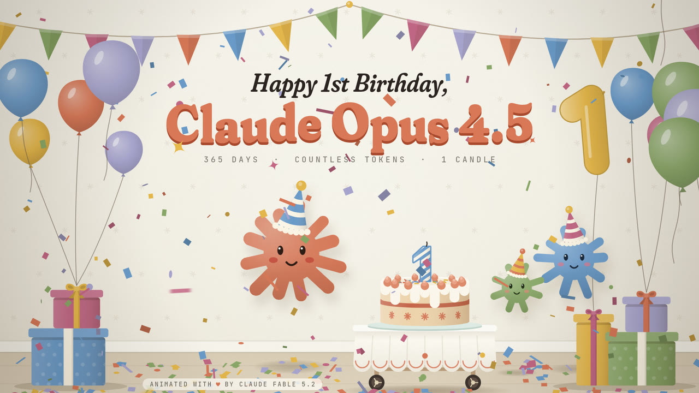

# fable_animations

Created in [T3 Code](https://t3.codes).

Code-driven animations: every frame is drawn by a plain JavaScript function, then rendered to MP4.

## Claude Opus 4.5 turns one

[](renders/opus-4.5-birthday.mp4)

**▶ [`renders/opus-4.5-birthday.mp4`](renders/opus-4.5-birthday.mp4)** — 24 seconds, 1920×1080, 60 fps, with sound.

Claude Opus 4.5 was released on November 24, 2025, so it turned one on November 24, 2026. The party, in 24 seconds:

| Time | What happens |
| --- | --- |
| 0:00 | The party room. A hat drops onto the birthday model; Haiku and Sonnet pop in and start singing. |
| 0:04 | Lights off. Haiku dashes away in the dark and wheels in the cake by candlelight. |
| 0:07 | "…dear Opus…" — the camera leans in, the birthday model blushes. |
| 0:13 | Eyes shut: `✻ Wishing… (esc to interrupt)`. |
| 0:16 | Deep breath, blow — darkness, and three pairs of eyes. |
| 0:18 | Lights on: confetti, balloons, *Happy 1st Birthday, Claude Opus 4.5*. |

### Watch it live

```sh
npm install
npm run preview        # → http://localhost:4600
```

The preview page plays the animation in the browser in real time (space = play/pause, ← → = step a frame, drag the bar to scrub). It runs exactly the code that produces the MP4.

### Render the MP4

Needs [Node.js](https://nodejs.org) 18+ and [ffmpeg](https://ffmpeg.org) on the `PATH`.

```sh
npm run render         # → renders/opus-4.5-birthday.mp4 (about 1½ minutes)
npm run render:hq      # same, lighter compression (bigger file)
npm run render:4k      # 3840×2160
npm run still -- 8.2   # a single frame as PNG → .cache/stills/
```

More switches (`node tools/render.mjs opus-birthday …`): `--no-credit` drops the "animated by" line, `--no-audio` the soundtrack, `--grain 0..1` sets the paper grain, `--fps 30`, `--from 13 --to 19` renders a section, `--sheet 0:24:1` writes a contact sheet.

### A party for another model

Who is being celebrated lives in three lines of [`opus-birthday/src/config.js`](opus-birthday/src/config.js) — name, release date, tagline. Change them and run `npm run render`; the title cards and the output file name follow (e.g. `renders/opus-4.6-birthday.mp4`).

### How it works

There is no video editor and no keyframe file. The whole film is one pure function:

```js
draw(ctx, t)   // paint the frame for time t (seconds) onto a Canvas 2D context
```

- **Picture** — plain Canvas 2D. In Node, [`@napi-rs/canvas`](https://github.com/Brooooooklyn/canvas) (Skia) draws each of the 1440 frames and pipes the raw pixels into ffmpeg; in the browser the same module draws onto a `<canvas>`. Because every frame depends only on `t`, frames can be rendered in any order and scrubbing is free.
- **Candlelight** — the scene is painted fully lit, then multiplied by a small light map (dark ambient + warm radial light from the flame). Rim light, long wall shadows and glowing eyes are drawn on top.
- **Sound** — synthesised in JavaScript, sample by sample: a music box playing "Happy Birthday to You" (public domain) with a small reverb, plus a few effects (light switch, breath, confetti). Picture and sound read the same timeline, which keeps them in sync.

```
opus-birthday/
  animation.js        entry point: meta, fonts, createAnimation(), renderAudio()
  index.html          live preview (preview.js, audio-worker.js)
  src/
    config.js         who the party is for: name, release date, tagline
    timeline.js       story beats + the song, shared by picture and sound
    scene.js          choreography, camera, and the order things are painted in
    character.js      the spark characters (one routine, three personalities)
    room.js           wall, floor, bunting, balloons, presents
    cake.js           trolley, cake, candle, flame, smoke, breath
    particles.js      confetti, music notes, sparkles, loose balloons
    lighting.js       the light map
    ui.js             titles, sing-along lyrics, the "Wishing…" pill, credits
    audio.js          the soundtrack synthesiser
    theme.js, util.js palette, fonts, easing, seeded randomness
tools/
  render.mjs          frames → ffmpeg → MP4 (also stills and contact sheets)
  serve.mjs           static server for the preview
```

To change the timing, edit `T` in `src/timeline.js`; colours live in `src/theme.js`; who does what, when, is in `src/scene.js`.

### Credits

- Typefaces: [Fraunces](https://github.com/undercasetype/Fraunces) and [JetBrains Mono](https://github.com/JetBrains/JetBrainsMono), both under the SIL Open Font License (see `assets/fonts/`).
- The characters are original drawings, a nod to Claude's spark.
- Designed, written and animated by Claude Fable 5.2.
